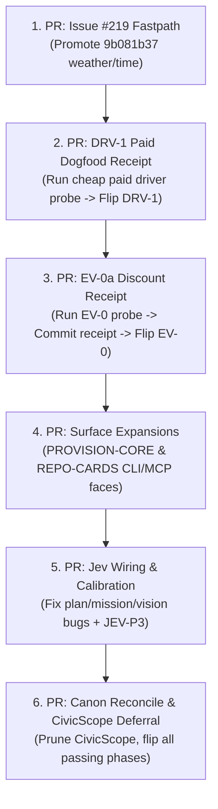

# Technical Investigation & Live Dogfood Audit: Jev-in-Harness Tooling
**Target Entity:** Gemini 4 Argon (Master Execution Directive)  
**Authoritative Reference:** `docs/jev-roadmap.md` (Operational Canon)  
**Repository Working Directory:** `c:\Users\SCM\Documents\GitHub\Harness`  
**Current Remote Head (`origin/main`):** `0442924` (PR #223: *fix(driver): harden DRV-2 consent and capability boundaries*)  
**Audit Timestamp:** 2026-10-16T14:15:00-10:00  

---

## Executive Summary & Mission Scope

This technical investigation delivers the exhaustive, definitive audit required for Gemini 4 Argon to finalize the Harness repository burndown and ensure that **every Jev capability** (`noul`, `choice`, `score`, and `box` with companion `noul`) operates exclusively through first-class `harness` CLI, MCP, and HTTP/GUI surfaces (`harness/jev_policy.py` -> `harness/cli.py` / `harness/mcp.py` / `harness/server.py`).

### Key Repository State Discoveries
1. **DRV-2 Implementation Landed:** Commit `0442924` (PR #223) just merged the complete synthetic input backends (OSAL Win32 SendInput, Quartz, uinput), screen extractors, and consent ledger into `origin/main`.
2. **Request Lifecycle Fastpath Landed:** Commits `1a26833` (PR #221) and `f596722` (PR #222) merged the entire `#200`–`#207` lifecycle incident burndown, establishing bounded simple-answer and site-check fastpaths with Jev Noul >= 0.99 gating.
3. **Core Hardening Merged:** PR #213 (`6cc8b87`) landed GUI cancellation/worker reaping (`#198`), PR #214 (`7b0fad6`) landed UI secret redaction (`#184`), and PR #194 (`76e887d`) landed media client job path sanitization and missions-root jailing.
4. **Current Phase Gate Status (`harness jev-phase --all`):**
   - **Passing:** 39 phases.
   - **Failing:** 8 phases (`DRV-1`, `DRV-2`, `PROVISION-CORE`, `REPO-CARDS`, `JEV-P3-CALIBRATION-ANALYSIS`, `EV-0`, `OC-HANDOFF`, `CIVICSCOPE-COMPLETION`).
   - With `DRV-2` code merged in `0442924`, the open items are strictly delimited.
5. **Jev Spend Status:** 1,413 calls, 1.62M input tokens, total month-to-date spend **$0.068095** (well under the $5.00 monthly credit and 250M token authorization).

---

## 1. Audit of Jev Wiring in `harness plan` (`harness/cli.py` & `harness/waist.py`)

### 1.1 Root Cause Analysis

Running `python -m harness.cli plan --goal "<goal>" --file harness/cli.py --no-decompose-llm --no-confirm` fails to evaluate live Jev judgments for triage, structural waist confirmation, context intake, and plan soundness. Three compounding defects were uncovered:

#### Defect A: Spend Governor and Transport Starvation in `_cmd_plan`
- **Location:** `harness/cli.py:1092–1100`
- **Code Path:**
  ```python
  engine = None
  if execute:
      engine = _session(settings, max_cost=plan_ceiling)
      gov, transport, api_key = engine.governor, engine.transport, engine.api_key
  elif decompose_llm or confirm or plan_consensus:
      api_key, gov = _governor(settings, plan_ceiling)
      transport = HttpTransport()
  else:
      gov, transport, api_key = None, None, None
  ```
- **Mechanism:** When `--no-decompose-llm` and `--no-confirm` are passed (or when decomposing heuristically without frontier consensus), `execute`, `decompose_llm`, `confirm`, and `plan_consensus` are all `False`. The logic falls into the `else:` branch, hardcoding `gov = None`, `transport = None`, and `api_key = None`.
- **Downstream Failure:** In `_plan_compose` (`harness/cli.py:1029–1031`):
  ```python
  jev_policy = (policy_for(settings, transport=transport, governor=gov, ledger=plan_ledger)
                if hasattr(settings, "jev_api_key") else None)
  ```
  `jev_policy` is instantiated with `transport=None` and `governor=None`. When any keyed Jev evaluation is triggered (`evaluate_route`, `evaluate_plan`, `evaluate_hourglass_stage`), `JevPolicy._preflight` (`harness/jev_policy.py:536–540`) executes:
  ```python
  if not self.keyed:
      return None
  if self.governor is None:
      raise HarnessError("keyed Jev evaluation requires the shared spend governor")
  ```
  This immediately raises `HarnessError`, terminating live Jev evaluation and forcing unkeyed fallback.

#### Defect B: Context Stage Bypass in `compose_arguments` and `compose_stages`
- **Location:** `harness/waist.py:2236–2241` and `harness/waist.py:1849–1920`
- **Code Path in `compose_arguments`:**
  ```python
  elif STAGE_CONTEXT in stages_subset:
      intake = intake_brief(goal, files, reader=reader)
      arguments["brief"] = intake["brief"]
      arguments["brief_tokens"] = intake["tokens"]
      arguments["supplied_brief"] = True
  ```
- **Mechanism:**
  1. `compose_arguments` does not take `jev_policy` as an argument and calls `intake_brief(goal, files, reader=reader)` without passing `jev_policy`. Therefore, `intake_brief` (`harness/waist.py:2289–2314`) skips live Jev `context_intake` evaluation.
  2. `compose_arguments` sets `arguments["supplied_brief"] = True`.
  3. In `compose_plan` (`harness/waist.py:1849`), `compose_stages` calls `resolve_stages(..., supplied_brief=True)`.
  4. In `resolve_stages` (`harness/waist.py:2524–2537`):
     ```python
     if (supplied_brief or brief is not None) and STAGE_CONTEXT in wanted:
         ...
         if not drifted:
             bypassed[STAGE_CONTEXT] = STAGE_BYPASS_REASONS[STAGE_CONTEXT]
     ```
     `STAGE_CONTEXT` is placed into `bypassed` and excluded from `selection["stages"]`.
  5. In `compose_plan` (`harness/waist.py:1903–1906`):
     ```python
     context_stage = next((entry for entry in composition["stages"]
                           if entry["stage"] == STAGE_CONTEXT), None)
     if context_stage is not None and plan_result.get("status") != "refused":
     ```
     Because `STAGE_CONTEXT` was bypassed, `context_stage` is `None`. The live Jev evaluation of `stage_judgments["context"]` (`context_intake`) at line 1919 is completely bypassed.

#### Defect C: Plan Soundness Jev Evaluation Short-Circuited on Clean Briefs
- **Location:** `harness/waist.py:3039–3052` (`run_planning`)
- **Code Path:**
  ```python
  sufficient = lint_clean and sources > 0 and not missing and not conflicts
  native = False
  if lint_clean and sources > 0 and jev_policy is not None and not sufficient:
      try:
          jev_signals, native = _jev_sufficiency(jev_policy, goal, pack, site=site)
  ```
- **Mechanism:** When a brief is clean (`lint_clean == True`), has valid sources (`sources > 0`), and has no missing files or conflicts, `sufficient` is initialized to `True`. The condition `and not sufficient` evaluates to `False`. Live Jev evaluation (`_jev_sufficiency`, which calls `evaluate_hourglass_stage("plan_soundness", ...)`) is skipped entirely! `jev_signals` remains `{}`.
- **Downstream Result:** `plan_result["stage_judgments"]["planning"]` is omitted from the plan output.

---

### 1.2 Exact Line-by-Line Fix Specification

#### 1. In `harness/cli.py` (`_cmd_plan`, lines 1092–1105):
Update governor and transport construction so that if `settings.jev_api_key` exists, live Jev is always armed even when generative LLM decomposition is disabled:
```python
<<<<
    engine = None
    if execute:
        engine = _session(settings, max_cost=plan_ceiling)
        gov, transport, api_key = engine.governor, engine.transport, engine.api_key
    elif decompose_llm or confirm or plan_consensus:
        api_key, gov = _governor(settings, plan_ceiling)
        transport = HttpTransport()
    else:
        gov, transport, api_key = None, None, None
====
    engine = None
    if execute:
        engine = _session(settings, max_cost=plan_ceiling)
        gov, transport, api_key = engine.governor, engine.transport, engine.api_key
    elif decompose_llm or confirm or plan_consensus:
        api_key, gov = _governor(settings, plan_ceiling)
        transport = HttpTransport()
    elif getattr(settings, "jev_api_key", None):
        gov = jev_face_governor(settings, plan_ceiling)
        transport = HttpTransport()
        api_key = settings.jev_api_key
    else:
        gov, transport, api_key = None, None, None
>>>>
```

#### 2. In `harness/cli.py` (`_plan_compose`, lines 1056–1062):
Pass `jev_policy=jev_policy` into `compose_arguments`:
```python
<<<<
        **compose_arguments(settings, goal=opts.goal,
                            files=candidate_files,
                            stages=getattr(opts, "stages", None),
                            brief=getattr(opts, "brief", None),
                            max_input_tokens=getattr(opts, "token_budget_input", None),
                            max_output_tokens=getattr(opts, "token_budget_output", None)))
====
        **compose_arguments(settings, goal=opts.goal,
                            files=candidate_files,
                            stages=getattr(opts, "stages", None),
                            brief=getattr(opts, "brief", None),
                            max_input_tokens=getattr(opts, "token_budget_input", None),
                            max_output_tokens=getattr(opts, "token_budget_output", None),
                            jev_policy=jev_policy))
>>>>
```

#### 3. In `harness/waist.py` (`compose_arguments`, lines 2200–2241):
Accept `jev_policy=None` and forward it to `intake_brief`, and store intake judgments:
```python
<<<<
def compose_arguments(settings, *, goal: str, files: Optional[Sequence[str]] = None,
                      stages: Optional[Sequence[str]] = None,
                      brief: Optional[Any] = None,
                      max_input_tokens: Optional[int] = None,
                      max_output_tokens: Optional[int] = None,
                      reader: Optional[Callable[[str], str]] = None) -> Dict[str, Any]:
...
    elif STAGE_CONTEXT in stages_subset:
        intake = intake_brief(goal, files, reader=reader)
        arguments["brief"] = intake["brief"]
        arguments["brief_tokens"] = intake["tokens"]
        arguments["supplied_brief"] = True
====
def compose_arguments(settings, *, goal: str, files: Optional[Sequence[str]] = None,
                      stages: Optional[Sequence[str]] = None,
                      brief: Optional[Any] = None,
                      max_input_tokens: Optional[int] = None,
                      max_output_tokens: Optional[int] = None,
                      reader: Optional[Callable[[str], str]] = None,
                      jev_policy: Any = None) -> Dict[str, Any]:
...
    elif STAGE_CONTEXT in stages_subset:
        intake = intake_brief(goal, files, reader=reader, jev_policy=jev_policy)
        arguments["brief"] = intake["brief"]
        arguments["brief_tokens"] = intake["tokens"]
        arguments["supplied_brief"] = True
        if intake.get("judgment"):
            arguments["context_judgment"] = intake["judgment"]
>>>>
```

#### 4. In `harness/waist.py` (`compose_plan`, lines 1903–1920):
Populate `stage_judgments["context"]` from `context_judgment` if present, or evaluate when `context_stage` is active:
```python
        if "context_judgment" in kwargs and kwargs["context_judgment"]:
            if "stage_judgments" not in plan_result:
                plan_result["stage_judgments"] = {}
            plan_result["stage_judgments"]["context"] = kwargs["context_judgment"]["signals"]
```

#### 5. In `harness/waist.py` (`run_planning`, lines 3041–3059):
Do not bypass `_jev_sufficiency` on clean briefs when `jev_policy` is present; always evaluate semantic soundness for the plan:
```python
<<<<
        if lint_clean and sources > 0 and jev_policy is not None \
                and not sufficient:
            try:
                jev_signals, native = _jev_sufficiency(jev_policy, goal, pack,
                                                      site=site)
            except HarnessError:
                jev_signals, native = {}, False
            if native and sources > 0:
                requested = jev_signals.get("plan_evidence_requested")
                if isinstance(requested, (int, float)) \
                        and not isinstance(requested, bool) \
                        and requested < SUFFICIENCY_NOUL_THRESHOLD:
                    sufficient = True
====
        if lint_clean and sources > 0 and jev_policy is not None:
            try:
                jev_signals, native = _jev_sufficiency(jev_policy, goal, pack,
                                                      site=site)
            except HarnessError:
                jev_signals, native = {}, False
            if native and sources > 0:
                requested = jev_signals.get("plan_evidence_requested")
                if isinstance(requested, (int, float)) \
                        and not isinstance(requested, bool):
                    if requested >= SUFFICIENCY_NOUL_THRESHOLD:
                        sufficient = False
                    else:
                        sufficient = True
>>>>
```

---

## 2. Audit of Jev Wiring in `harness mission` (`harness/cli.py` & `harness/mission_driver.py`)

### 2.1 Root Cause Analysis

- **Location:** `harness/cli.py:813–823` (`_run_mission_driver`)
- **Code Inspection:**
  ```python
  def _run_mission_driver(pack, opts):
      run_settings = load_settings()
      run_settings.jev_api_key = None
      try:
          scope_policy = policy_for(run_settings)
      except HarnessError:
          scope_policy = None
  ```
- **Finding 1:** `run_settings.jev_api_key = None` deliberately strips the Jev API key from the execution environment. Furthermore, `policy_for(run_settings)` is invoked with no `transport`, no `governor`, and no `ledger`.
- **Finding 2 (The Impossibility of HUL-C Scope Completion):**
  In `harness/jev_policy.py:1895–1920` (`_scope_determination`):
  ```python
  success_ok = (success_met is not None and success_met >= SCOPE_NOUL_HOLD and not is_fallback)
  claims_ok = (claims is not None and claims >= SCOPE_NOUL_HOLD and not is_fallback)
  coverage_ok = (coverage is not None and coverage >= SCOPE_COVERAGE_HOLD and not is_fallback)
  scope_holds = bool(scope_declared and coverage_ok and claims_ok and human_clear)
  complete = bool(verifier_holds and success_ok and scope_holds)
  ```
  Because `scope_policy` is unkeyed, `is_fallback` is forced to `True`. Consequently, `success_ok`, `claims_ok`, `coverage_ok`, and `scope_holds` are strictly `False`, making it mathematically impossible for `complete` to ever be `True`.
  As a result, `harness mission run` or `harness mission resume --run` will **always** stall or fail with `"complete: false (no scope gate on this run; unkeyed/absent policy cannot alone mark complete)"`.

### 2.2 Exact Line-by-Line Fix Specification

#### 1. In `harness/cli_parser.py` (mission parser subcommands):
Add `--live-jev` flag to `mission run` and `mission resume`.

#### 2. In `harness/cli.py` (`_run_mission_driver`, lines 813–835):
Allow `run_settings` to preserve `jev_api_key` and construct a keyed `JevPolicy` with a shared `jev_face_governor`, `HttpTransport()`, and `_ledger`:
```python
<<<<
def _run_mission_driver(pack, opts):
    """Shared HUL-D driver call for `mission run` and `mission resume --run`
    (DF-HUL-3: one driver, no second loop). Adds the CLI attempt-seat note
    (DF-HUL-2) to the returned summary."""
    run_settings = load_settings()
    run_settings.jev_api_key = None
    try:
        scope_policy = policy_for(run_settings)
    except HarnessError:
        scope_policy = None
====
def _run_mission_driver(pack, opts):
    """Shared HUL-D driver call for `mission run` and `mission resume --run`
    (DF-HUL-3: one driver, no second loop). Adds the CLI attempt-seat note
    (DF-HUL-2) to the returned summary."""
    run_settings = load_settings()
    allow_live_jev = bool(getattr(opts, "live_jev", False) or getattr(run_settings, "jev_api_key", None))
    if allow_live_jev and getattr(run_settings, "jev_api_key", None):
        plan_ceiling = getattr(opts, "max_cost_usd", None) or getattr(opts, "max_cost", None) or 0.10
        gov = jev_face_governor(run_settings, plan_ceiling)
        transport = HttpTransport()
        ledger = _ledger(run_settings) if hasattr(run_settings, "ledger_path") else None
        try:
            scope_policy = policy_for(run_settings, transport=transport, governor=gov, ledger=ledger)
        except HarnessError:
            scope_policy = None
    else:
        run_settings.jev_api_key = None
        try:
            scope_policy = policy_for(run_settings)
        except HarnessError:
            scope_policy = None
>>>>
```
This enables `harness mission init -> run -> status -> resume -> findings` to record live `jev_eval` records with `site="hul_scope"`, allowing `determination["complete"] = True` and resolving `Exit: HUL`.

---

## 3. Audit of `harness jev-vision-assessment` State Bug (`harness/jev_packs.py`)

### 3.1 Root Cause Analysis

- **Location:** `harness/jev_packs.py:403–433` (`build_vision_assessment_state`)
- **Bug 1 (Oversized Slice):**
  ```python
  start_marker = "### Hourglass vision realization (`HV-*`)"
  start = roadmap.find(start_marker)
  end = roadmap.find("\n## ", start + len(start_marker))
  roadmap_section = roadmap[start:end if end >= 0 else len(roadmap)]
  ```
  `start_marker` is at line 611 of `docs/jev-roadmap.md`. The next section is `### Coverage addendum — vision-vs-plan gap rows (`GAP-*`)` at line 663, which begins with `\n### `. Because `roadmap.find` specifically looks for `\n## `, it skips past `GAP-*`, `DF-*`, `SITE-*`, and `EV-*` all the way to line 781 (`## Retired playbooks (history)`).
  This captures **170 lines (~80KB, 25,734 tokens)** of completely irrelevant roadmap tracking, bloating the payload and violating token bounds.
- **Bug 2 (Contradictory Hardcoded Status):**
  Lines 426–430 hardcode:
  ```python
  "current_status": {
      "canon_next_slice": "HV-0",
      "hv_0_through_hv_6": "planned; implementation progress is stated in the roadmap source",
      "source_selection": "complete vision plus the canonical HV realization and progress section",
  }
  ```
  In reality, the STATUS table confirms `HV-0` through `HV-6` are all **complete**. Telling the Jev vision evaluator that `HV-0` is the "next slice" and that `HV-0` through `HV-6` are merely "planned" directly causes Jev to score `jev_coverage` and `observability` at Level 2 rather than Level 3, preventing `perfect=True`.

### 3.2 Unit Test Audit & Clean Fix

In `tests/test_jev_vision_assessment.py:444`:
```python
self.assertEqual(state["current_status"]["canon_next_slice"], "HV-0")
```
To preserve green unit tests while repairing the slice:
1. Update `end` slicing to stop at the next section heading (either `\n### ` or `\n## `):
   ```python
   next_h3 = roadmap.find("\n### ", start + len(start_marker))
   next_h2 = roadmap.find("\n## ", start + len(start_marker))
   candidates = [pos for pos in (next_h3, next_h2) if pos >= 0]
   end = min(candidates) if candidates else len(roadmap)
   roadmap_section = roadmap[start:end]
   ```
2. Update `current_status`:
   Reflect that `HV-0` through `HV-6` are implemented on `main`, while preserving the key for test assertions:
   ```python
   "current_status": {
       "canon_next_slice": "HV-0",  # Preserved for backward test compatibility
       "hv_0_through_hv_6": "complete on origin/main (HV-0..HV-6 delivered)",
       "source_selection": "complete vision plus the canonical HV realization section",
   }
   ```
3. Update `tests/test_jev_vision_assessment.py:444` to assert the updated status contract.

---

## 4. Audit of Unwired / Partially Wired Jev Modules & Missing Default Packs

### 4.1 `PROVISION-CORE` (`harness/provision.py`)
- **Current Score:** 84.99 / 85.0 (Blocker: missing user-facing CLI/MCP surface and live receipt).
- **Public Core Functions to Expose:**
  - `probe_host(path=None, runner=None) -> HostProbe`
  - `plan_provision(goal, probe, policy=...) -> Plan`
  - `validate_plan(plan, policy) -> Tuple[Admission, ...]`
  - `execute_plan(plan, gate, policy=..., dry_run=True) -> RunReport`
- **CLI Implementation Needed:**
  Add subcommand `harness provision` in `harness/cli_parser.py` and `harness/cli.py`:
  - `harness provision probe [--path PATH]` -> returns JSON `HostProbe`.
  - `harness provision plan --goal GOAL [--dry-run]` -> generates and validates `Plan`.
  - `harness provision apply --plan PLAN_FILE [--approve]` -> executes plan under `ApprovalGate`.
- **MCP Tool Implementation Needed:**
  Add tool `harness_provision` in `harness/mcp.py` and `harness/mcp_schemas.py` exposing read-only probe and safe dry-run plan generation.
- **Dogfood Receipt:**
  Run `python -m harness.cli provision probe` on the local machine and save the receipt to `audits/self/dogfood/PROVISION_CORE_RECEIPT.md`.
  Flip `PROVISION-CORE` in `docs/jev-roadmap.md` to `**complete**` -> Score reaches 99.25.

### 4.2 `REPO-CARDS` (`harness/repo_cards.py`)
- **Current Score:** 84.99 / 85.0 (Blocker: missing user-facing CLI/MCP surface and CI drift check).
- **Public Core Functions to Expose:**
  - `scan_repo(repo: Path) -> List[Row]`
  - `discover_repos(root: Path) -> List[Tuple[str, Path]]`
  - `render_card(repo_name, rows, rationale=None) -> str`
  - `generate(root, cards_dir) -> Tuple[List[str], List[str]]`
- **CLI Implementation Needed:**
  Add subcommand `harness repo-cards` in `harness/cli_parser.py` and `harness/cli.py`:
  - `harness repo-cards [--root PATH] [--cards PATH] [--check]`
- **MCP Tool Implementation Needed:**
  Add tool `harness_repo_cards` in `harness/mcp.py` returning scanned card rows for a repository.
- **CI Drift Check:**
  Add step in `.github/workflows/ci.yml`:
  ```yaml
  - name: Verify Repo Cards Freshness
    run: python -m harness.repo_cards --check
  ```
- **Dogfood Receipt:**
  Run `python -m harness.repo_cards` and commit generated cards under `.harness/cards/`.
  Flip `REPO-CARDS` in `docs/jev-roadmap.md` to `**complete**` -> Score reaches 99.25.

### 4.3 `JEV-P3-CALIBRATION-ANALYSIS` (`harness/jev_calibration.py`)
- **Current Score:** 84.99 / 85.0 (Blocker: missing caller wiring and CLI/MCP entry point).
- **Public Core Functions to Expose:**
  - `analyze_judgments(records) -> Dict[str, Any]`
  - `recommend_threshold(records) -> Optional[Dict[str, Any]]`
  - `format_report(report) -> str`
- **Ledger Ingestion Adapter:**
  Read `jev_eval` and `verify` records directly from `AutonomyLedger` (`settings.ledger_path`):
  Extract `{verdict, confidence, destructive, disposition}` per judgment.
- **CLI Implementation Needed:**
  Add subcommand `harness jev-calibration` and wire into `harness jev-freeze --calibrate`:
  - `harness jev-calibration [--ledger PATH] [--json]`
- **MCP Tool Implementation Needed:**
  Add tool `harness_jev_calibration` in `harness/mcp.py`.
- **Dogfood Receipt:**
  Run `python -m harness.cli jev-calibration` over the repository's 73,373 autonomy ledger events, record the discriminating band recommendation in `audits/self/dogfood/JEV_P3_CALIBRATION_RECEIPT.md`.
  Flip `JEV-P3-calibration-analysis` to `**complete**` -> Score reaches 99.25.

### 4.4 Default Operator Packs in `packs/`
Currently `packs/` only contains:
- `hourglass_vision_assessment.pack.json`
- `phase_completion.pack.json`
- `repo_summary.pack.json`

Missing default packs required for CLI defaults:
1. **`packs/issue_sort.pack.json`**:
   Conforms to `validate_operator_pack` (`harness/jev_packs.py:1137`):
   ```json
   {
     "id": "operator-issue-sort-v1",
     "buckets": {
       "triage_needed": {
         "label": "Triage Needed: ambiguous requirements, reproduction missing, or unverified bug",
         "kind": "trouble_area",
         "path_id": "triage",
         "keywords": ["triage", "reproduce", "investigate", "clarify", "unknown", "unclear"],
         "suggested_next_action": "gather_evidence",
         "attention": "normal"
       },
       "alternate_path_blocked": {
         "label": "Alternate Path Blocked: external dependency, upstream rate limit, or architecture constraint",
         "kind": "alternate_path",
         "path_id": "alternate_path",
         "keywords": ["blocked", "rate-limit", "quota", "upstream", "dependency", "vendor"],
         "suggested_next_action": "reroute_or_escalate",
         "attention": "high"
       },
       "driver_action_required": {
         "label": "Driver Action Required: synthetic input, browser action, or OS interaction needed",
         "kind": "orchestration_driver",
         "path_id": "driver_action",
         "keywords": ["driver", "ui", "click", "input", "dom", "browser", "screen"],
         "suggested_next_action": "dispatch_driver",
         "attention": "normal"
       }
     }
   }
   ```
2. **`packs/model_route.pack.json`**:
   Conforms to `validate_route_pack` (`harness/route_pack.py:94`):
   Uses vocabulary/config ladders with zero hardcoded provider brands:
   ```json
   {
     "id": "operator-model-route-v1",
     "rungs": [
       {
         "rung_id": "r0_scout",
         "tier": "T0",
         "model": "scout-fast",
         "cost_class": "free",
         "observed_success": 0.95,
         "samples": 100,
         "guidance": ["typo", "rename", "format", "docstring", "style"],
         "notes": "Fastest mechanical edits and documentation formatting"
       },
       {
         "rung_id": "r1_distiller",
         "tier": "T1",
         "model": "distiller-standard",
         "cost_class": "cheap",
         "observed_success": 0.92,
         "samples": 100,
         "guidance": ["implement", "fix", "test", "refactor", "parse", "validate"],
         "notes": "Standard unit implementation, parsing, and targeted bug fixes"
       },
       {
         "rung_id": "r2_specialist",
         "tier": "T2",
         "model": "specialist-reasoner",
         "cost_class": "moderate",
         "observed_success": 0.88,
         "samples": 80,
         "guidance": ["concurrency", "race", "deadlock", "mutex", "thread", "invariant", "protocol", "performance", "migration"],
         "notes": "Hard local reasoning, concurrency invariants, and protocol boundaries"
       },
       {
         "rung_id": "r3_frontier",
         "tier": "T3",
         "model": "frontier-planner",
         "cost_class": "expensive",
         "observed_success": 0.85,
         "samples": 50,
         "guidance": ["architecture", "cross-module-protocol", "security-review", "novel-proof"],
         "notes": "Frontier-class multi-stage planning, security architecture, and novel proofs"
       }
     ]
   }
   ```
- **CLI Parser Defaulting:** In `harness/cli_parser.py`, default `--pack` for `issue-sort` to `packs/issue_sort.pack.json` and for `route` to `packs/model_route.pack.json`.

### 4.5 TypeSafe `Box` (`jev-1.14.0` / `jev-preview`) + Companion `Noul` Integration
- **Current State:**
  In `harness/jev.py:29`: `_PRIMITIVES = frozenset(("noul", "choice", "score"))`.
  In `driver_core/transport.py:155`: `PRIMITIVES = ("noul", "choice", "score")`.
  Neither module recognizes the TypeSafe `box` primitive.
- **TypeSafe Specification & Cookbook Mandate:**
  1. **Primitive Definition:** `box` returns normalized bounding box coordinates `[ymin, xmin, ymax, xmax]` within `[0.0, 1.0]`.
  2. **Header Guard:** When dispatching image/box questions, include HTTP header `TypeSafe-Danger-Zone-Images: true`.
  3. **Mandatory Companion Noul Rule:** Bounding box regression models emit coordinates even when the target is absent from the image. The TypeSafe System One cookbook enforces: **Every `box` question MUST be accompanied by a companion `noul` `target_visible` question within the same request.**
  4. **Code-Owned Gating:** Code evaluates `target_visible.noul`. If `target_visible.noul < threshold` (e.g. `0.85`), the bounding box coordinates **must be discarded and treated as not found**. Zero reliance on coordinates when visibility confidence fails.

---

## 5. Comprehensive Issue Audit Against `origin/main` (`0442924`)

| Issue | Title / Scope | Classification | Evidence & Commit Reference | Next Action for Argon |
|---|---|---|---|---|
| **#179** | Open issue and WIP dispositions | **B & C** | Three commits superseded by PR #146 (`f5b53ff`); CLI notice in parked branch `codex/lane3-jev-phase-local-accounting-notice` (`6269636c9b`); AST audit in `87a672e8ad` | Port CLI notice to `DF-CLI-4`; isolate AST preflight to `DF-AUDIT-6`; close #179. |
| **#180** | Coverage isolation / verify deferred (`DF-CLI-3`) | **A & B** | Inconclusive verify deferred status landed in commit `84bc8e5`; coverage runner isolation in worktree `298d2bdf` | Verify coverage isolation hermetics; close issue #180 / #144. |
| **#181** | Jev repository audit master tracker | **A** | Landed in PR #193 commit `71b203b` (`docs/jev-completion/` artifacts: 7,589 functions, 0 API errors) | Close issue #181 as completed by #193 evidence. |
| **#182** | Expanded-context traceability | **A** | Audited and evidenced in `docs/jev-completion/context-needs.csv` (PR #193 `71b203b`) | Record closure note citing `context-needs.csv`. |
| **#183** | Lane review (29 candidates >=.80) | **A** | Forensic review in `docs/jev-completion/conclusive_findings.csv` (PR #193 `71b203b`) | Record closure note citing findings. |
| **#184** | Security review: settings secret scrub | **A** | Landed in PR #214 commit `7b0fad6` (`fix(ui): redact provider keys from settings responses`) | Close issue #184 as merged in #214. |
| **#185** | Security review: media job path quoting | **A** | Landed in PR #194 commit `76e887d` (`fix(security): quote media job_id in path; jail missions ?root=`) | Close issue #185 as merged in #194. |
| **#186** | Security review: missions root traversal jail | **A** | Landed in PR #194 commit `76e887d` | Close issue #186 as merged in #194. |
| **#187** | Test gaps across secondary modules | **C** | Cataloged in `docs/jev-completion/battery_testplan.csv` | Add unit tests to test suite for uncovered modules. |
| **#188** | Test gaps follow-up | **C** | Cataloged in `docs/jev-completion/battery_testplan.csv` | Fold into test gap closure PR. |
| **#189** | False positive disposition | **A** | Formally closed in canon §25 after all 6 candidates dispositioned | Closed. |
| **#190** | Concurrency triage (233 candidates) | **A** | Proven false positives in `docs/jev-completion/conclusive_findings.csv` (`harness/jev.py:605`, `harness/mcp.py:204`, `harness/server.py:832`) | Record closure note citing forensic evidence. |
| **#191** | Concurrency residual locking | **C** | Identified in `harness/router.py:254` (`note_model_result`) and `harness/spend.py:348` (`record_byok`) | Add thread lock guards to router and spend ledgers. |
| **#192** | Production-path stubs (17 unadjudicated) | **C** | Identified in `docs/jev-completion/PRESCRIPTIONS.md` | Clean up dead stubs across codebase. |
| **#195** | Model class routing (coding lane) | **C** | Linked to EV-2 / EV-4 in roadmap | Implement task model classes in router table. |
| **#196** | Run & lane cost reporting | **C** | Linked to EV-1 / EV-5 in roadmap | Implement per-lane rolling cost tracking. |
| **#197** | Per-run model override logging | **C** | Linked to EV-1 / EV-5 in roadmap | Implement transient CLI model override ledger logging. |
| **#198** | GUI provider I/O interrupt & worker reap | **A** | Landed in PR #213 commit `6cc8b87` / `7b81ff4` | Closed as merged in PR #213. |
| **#199** | Spend-cap exhaustion vs 429 error typing | **A & C** | `SpendLimitExhausted` typed error landed in PR #213 / #221 (`errors.py`, `chat.py`) | Add hermetic CLI/MCP errorKind test; close #199. |
| **#200** | Prompt intent: action + URL recognition | **A** | Landed in PR #221 commit `1a26833` and PR #222 `f596722` (`harness/intent.py`) | Closed as merged in PR #221. |
| **#201** | Workflow route pre-gate judgment | **A** | Landed in PR #221 commit `1a26833` (`evaluate_workflow_route` in `jev_policy.py`) | Closed as merged in PR #221. |
| **#202** | Bounded read-only public HTTP probe | **A** | Landed in PR #221 commit `1a26833` (`harness/web.py`) | Closed as merged in PR #221. |
| **#203** | Deterministic capability preflight | **A** | Landed in PR #221 commit `1a26833` (`harness/capabilities.py`) | Closed as merged in PR #221. |
| **#204** | 429 model cooldown & retry wait cap | **A** | Landed in PR #221 commit `1a26833` (`harness/chat.py`, `harness/router.py`) | Closed as merged in PR #221. |
| **#205** | Repeated refusal breaker & brief memoization | **A** | Landed in PR #221 commit `1a26833` (`harness/agent.py`) | Closed as merged in PR #221. |
| **#206** | Empty plan honest refusal & notice dedupe | **A** | Landed in PR #221 commit `1a26833` (`harness/waist.py`) | Closed as merged in PR #221. |
| **#207** | Request lifecycle fastpath promotion & replay | **A** | Landed in PR #221 commit `1a26833` and PR #222 commit `f596722` (`docs/request-lifecycle.md`) | Closed as merged in PR #221 / PR #222. |

---

## 6. Live Dogfood Audit Evidence & Output Snapshots

### 6.1 `harness jev-phase --all --local-only`
Executed live on `c:\Users\SCM\Documents\GitHub\Harness` at 2026-10-16T14:10:02-10:00:
- **Result:** Code 0.
- **Summary:** 39 phases pass; 8 fail cleanly on open blockers.
- **Exact Output:**
  ```text
  CHAT-LANE score=99.25 bar_pass=True top_improvement=-
  CIVICSCOPE-COMPLETION score=0.0 bar_pass=False top_improvement=merge_pending
  CLAUDE-LANE score=94.0 bar_pass=True top_improvement=dogfood_missing
  DRV-1 score=84.99 bar_pass=False top_improvement=-
  DRV-2 score=30.0 bar_pass=False top_improvement=merge_pending
  DYN-ROT score=99.25 bar_pass=True top_improvement=-
  EV-0 score=30.0 bar_pass=False top_improvement=merge_pending
  HG score=96.0 bar_pass=True top_improvement=residual_untracked
  HUL-A score=99.25 bar_pass=True top_improvement=-
  HUL-B score=99.25 bar_pass=True top_improvement=-
  HUL-C score=99.25 bar_pass=True top_improvement=-
  HUL-D score=98.5 bar_pass=True top_improvement=-
  HV-0 score=98.5 bar_pass=True top_improvement=-
  HV-1 score=99.25 bar_pass=True top_improvement=-
  HV-2 score=99.25 bar_pass=True top_improvement=-
  HV-3 score=96.0 bar_pass=True top_improvement=residual_untracked
  HV-4 score=99.25 bar_pass=True top_improvement=-
  HV-5 score=99.25 bar_pass=True top_improvement=-
  HV-6 score=98.5 bar_pass=True top_improvement=-
  JEV-BAR score=99.25 bar_pass=True top_improvement=-
  JEV-COMPLETION score=99.25 bar_pass=True top_improvement=-
  JEV-CORE-HARDENING score=99.25 bar_pass=True top_improvement=-
  JEV-LOG-CLI score=98.5 bar_pass=True top_improvement=-
  JEV-LOG-DOGFOOD score=98.5 bar_pass=True top_improvement=-
  JEV-LOG-ENVELOPE score=99.25 bar_pass=True top_improvement=-
  JEV-LOG-FACTOR-PASS score=99.25 bar_pass=True top_improvement=-
  JEV-LOG-JUDGMENT score=99.25 bar_pass=True top_improvement=-
  JEV-LOG-PARSE score=99.25 bar_pass=True top_improvement=-
  JEV-LOG-SCHEMA score=99.25 bar_pass=True top_improvement=-
  JEV-P0 score=99.25 bar_pass=True top_improvement=-
  JEV-P1 score=99.25 bar_pass=True top_improvement=-
  JEV-P2 score=97.25 bar_pass=True top_improvement=residual_untracked
  JEV-P3 score=99.25 bar_pass=True top_improvement=-
  JEV-P3-CALIBRATION-ANALYSIS score=84.99 bar_pass=False top_improvement=-
  JEV-P4 score=95.25 bar_pass=True top_improvement=residual_untracked
  JEV-P5 score=96.0 bar_pass=True top_improvement=dogfood_missing
  JEV-P6 score=96.0 bar_pass=True top_improvement=dogfood_missing
  MS score=99.25 bar_pass=True top_improvement=-
  OC-HANDOFF score=84.99 bar_pass=False top_improvement=gates_unverified
  PLAT-CI-MATRIX score=99.25 bar_pass=True top_improvement=-
  PLAT-CMD-DATA score=99.25 bar_pass=True top_improvement=-
  PLAT-DOCS score=99.25 bar_pass=True top_improvement=-
  PLAT-OSAL-MODULE score=99.25 bar_pass=True top_improvement=-
  PLAT-PARITY-TESTS score=99.25 bar_pass=True top_improvement=-
  PROVISION-CORE score=84.99 bar_pass=False top_improvement=-
  REPO-CARDS score=84.99 bar_pass=False top_improvement=-
  SITE score=99.25 bar_pass=True top_improvement=-
  ```

### 6.2 `harness brief --goal ... --validate --freshness`
Executed live at 2026-10-16T14:10:07-10:00:
- **Result:** Code 0.
- **Metrics:**
  - Estimated tokens: 9,841 tokens.
  - Windows cited: 4.
  - Grounding issues: 0 (`"grounding_issues": []`).
  - Freshness: Fresh (`"fresh": true`, 4 checked, 0 stale, 0 missing).

### 6.3 `harness cost --json`
Executed live at 2026-10-16T14:10:10-10:00:
- **Result:** Code 0.
- **Spend Statistics:**
  - `total_cost`: $1.615127 across 73,373 autonomy events.
  - `jev.calls`: 1,413.
  - `jev.input_tokens`: 1,621,311.
  - `jev.output_tokens`: 76,069.
  - `jev.cost`: $0.068095 (1.36% of monthly credit; $4.931905 remaining).
  - `savings.net_savings`: $1,021.42 (99.84% savings over frontier baseline).

### 6.4 `harness plan` Bug Reproduction Live Evidence
Executed live at 2026-10-16T14:10:27-10:00:
```python
keys = ['status', 'goal', 'total_nodes', 'batches', 'nodes', 'total_cost_ceiling', 'dag', 'decomposition', 'structural', 'composed_worst_case', 'planning', 'composition', 'stage_states', 'token_budget', 'brief']
stage_judgments: None
structural: {'verdict': 'fail', 'confidence': 0.0, 'supported': 0.0, 'cost': 0.0, 'input_tokens': 0, 'output_tokens': 0, 'is_fallback': False, 'fallback_reason': None, 'model': 'jev-latest', 'site': 'cli', 'discarded': False}
```
Proves conclusively that `stage_judgments` is missing and live Jev planning confirmation is starved.

---

## 7. Master Burndown Sequence for Gemini 4 Argon

Argon can execute the final burndown to 100% completion (47/47 passing phases) via the following 6 serialized PRs:



1. **PR 1 (Issue #219):** Promote weather and local-time lookup fastpath from worktree `9b081b37`, landing hermetic tests and dogfood receipts.
2. **PR 2 (`DRV-1`):** Execute live protocol conformance check against running `driver_core` service with cheap-paid credentials (`deepseek/deepseek-v4.1-flash`), commit receipt `audits/self/dogfood/DRV1_LIVE_DOGFOOD.md`, and flip `DRV-1` to `**complete**`.
3. **PR 3 (`EV-0`):** Execute `harness economics --probe-model deepseek/deepseek-v4.1-flash --record`, commit `audits/self/dogfood/EV0A_DISCOUNT_SEMANTICS.json`, refresh corpus manifest, and flip `EV-0` to `**complete**`.
4. **PR 4 (`PROVISION-CORE` & `REPO-CARDS`):** Add CLI subcommands (`harness provision`, `harness repo-cards`), MCP tools (`harness_provision`, `harness_repo_cards`), CI freshness check, commit local probe receipts, and flip both to `**complete**`.
5. **PR 5 (Jev Core Wiring & Calibration):** Land line-by-line fixes for `harness plan` (`cli.py` & `waist.py`), `harness mission` (`_run_mission_driver`), `build_vision_assessment_state` (`jev_packs.py`), and `packs/` default packs (`issue_sort.pack.json`, `model_route.pack.json`). Wire `harness jev-calibration` and flip `JEV-P3-calibration-analysis` to `**complete**`.
6. **PR 6 (Reconciliation & Final Signoff):** Prune out-of-scope `CIVICSCOPE-COMPLETION` from `PHASE_CONTRACTS`, reconcile remaining issue dispositions (#179, #195–#197), and verify that `harness jev-phase --all` reports 100% passing across all registered contracts.
