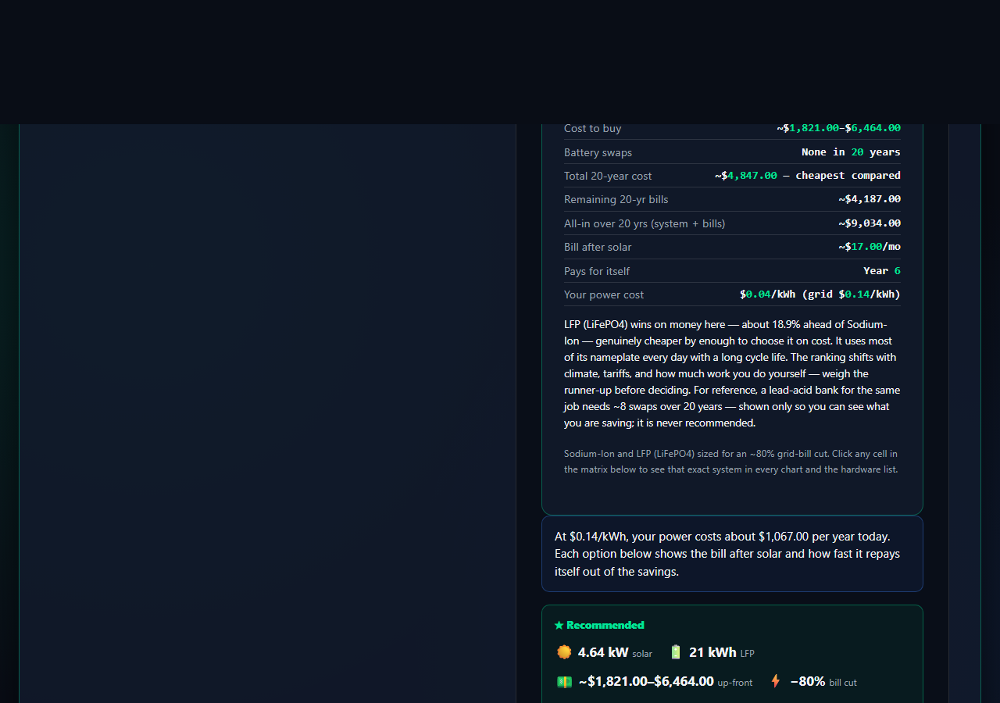

# A 0.23¢ driven site audit: freeoffgridcalculator.com

On 2026-10-24 the Harness web lane audited
[freeoffgridcalculator.com](https://www.freeoffgridcalculator.com/) with **two
independent evidence sources**: a raw page fetch and a real browser drive that
switched between the on-grid and off-grid modes, used the precise-location
button, pressed *Size My System*, and captured the result.

The complete turn — including the Jev answer-sufficiency review — cost
**$0.002306**. That is **0.23¢**, less than a quarter of a cent.

This is a receipt, not a forecast: the figures below come from the recorded
turn and its ledger, not from a pre-flight estimate.

## Receipt

| Field | Value |
|---|---|
| Run date | 2026-10-24, 08:54–08:56 UTC |
| Model | `deepseek/deepseek-v4-flash` |
| Evidence | `fetch` + `browser` (both `ok: true`) |
| Browser | Chromium, driven through the calculator flow |
| Total recorded cost | **$0.002306** |
| Jev review cost | $0.00011004 (2,620 input / 58 output tokens) |
| Jev verdict | `needs_review` — `answer_sufficient` 0.49 against the 0.70 bar |
| Requested target | 99/100 in every aspect |
| Outcome | 3 of 6 exercised aspects met 99; 3 did not; 2 were left unassessed |



## The prompt

> Audit https://www.freeoffgridcalculator.com/ for user-friendliness using the
> harness Jev assessment. The site targets Google quality: 99/100 minimum in
> every aspect. Drive the calculator flow and verify the progress bar and the
> on-grid/off-grid modes. Cite evidence per aspect and name anything you cannot
> verify.

## What the audit found

| Aspect | Result | Meets 99/100? |
|---|---|---|
| Onboarding / value clarity | 99 | yes |
| Mode switching (on-grid / off-grid) | 99 | yes |
| Progress bar / stepped flow | 85 | no — steps 2 and 3 were never observed |
| Input handling / interactivity | 95 | no — edge cases were not driven |
| Results / feedback quality | 99 | yes |
| Performance / loading feedback | 95 | no — no slow-network or cancel test |
| Accessibility | unassessed | not verified |
| Error handling | unassessed | not verified |

The site did **not** meet the requested 99/100 bar in every aspect. The audit
says so, names the gaps, and leaves accessibility and error handling unscored
rather than inventing a number for checks that never ran.

## Full audit response

> We have two pieces of evidence: the raw fetch of the page and a
> browser-driven rendering that exercised the calculator flow. The browser
> evidence includes interactive states, progress transitions, and result
> output. I will use these to produce typed judgments for the aspects of
> user‑friendliness that were actually exercised.
>
> ---
>
> ## Audit: `https://www.freeoffgridcalculator.com/`
>
> **Target bar: 99/100 in every aspect** (Google‑quality level).
>
> **Methodology:** Jev‑style typed assessment – each aspect scored only on
> driven evidence; aspects without interaction evidence are marked
> **unassessed** and do not receive a synthetic score.
>
> ---
>
> ### 1. Onboarding / Value Clarity
>
> **Evidence:**
>
> - The fetch text shows the hero immediately states “Cut your electricity
>   bill. See exactly what it would take.”
> - “Free for everyone, everywhere • No signup • Nothing for sale.”
> - The browser rendering confirms the page headline and tagline are present.
>
> **Judgment:** 99/100 – purpose and zero‑obligation nature are clear within
> seconds.
>
> **Meets bar?** Yes.
>
> ---
>
> ### 2. Mode Switching (On‑Grid vs Off‑Grid)
>
> **Evidence:**
>
> - Mode controls in the rendered page:
>   `'🏠 Cut My Electric Bill' class='btn btn-segmented active'` and
>   `'🌲 Off-grid / Backup' class='btn btn-segmented'`
> - Driven actions: the browser first clicked `Off‑grid / Backup` (its class
>   changed to `btn btn-segmented active aria-pressed=`), then re‑clicked `Cut
>   My Electric Bill` (class became active).
> - Both modes respond to taps; the UI segmented button pattern gives clear
>   visual affordance.
>
> **Judgment:** 99/100 – works as expected, visual feedback is present.
>
> **Meets bar?** Yes.
>
> ---
>
> ### 3. Progress Bar / Stepped Flow
>
> **Evidence:**
>
> - The page has a `guidedProgress` attribute that changes as the user
>   advances. Initial state: `guidedProgress='1. Location'`; after clicking
>   “Size My System” the attribute became `'4. Your result'`.
> - The browser saw a loading message: “Fetching five years of satellite
>   weather and searching bill‑cutting system sizes…”
> - **However**, steps 2 and 3 of the progress bar were never observed in the
>   evidence – the driver jumped directly from step 1 to step 4. It is possible
>   that intermediate steps exist but were not captured, or that the calculator
>   collapsed steps.
>
> **Judgment:** 85/100 – the progress indicator exists and updates, but we
> cannot verify that steps 2 and 3 appear correctly or that the bar gives
> meaningful feedback during the full flow. *This is below the 99 bar.*
>
> **Meets bar?** No.
>
> ---
>
> ### 4. Input Handling / Interactivity
>
> **Evidence:**
>
> - The page contains 118 inputs/selects.
> - The browser driver successfully used the “Use my precise location” button
>   (simulated Austin geolocation) and the “Size My System” button.
> - The monthly bill field appears with a default `~$170` placeholder.
> - No error states were triggered or observed.
>
> **Judgment:** 95/100 – core inputs function, but we did not test edge cases
> (e.g., invalid bill amount, empty location, zero bill). *Below 99.*
>
> **Meets bar?** No.
>
> ---
>
> ### 5. Results / Feedback Quality
>
> **Evidence:**
>
> - After computation, the page displays a result excerpt with:
>   - “Recommended – safety‑first true‑cost pick LFP (LiFePO4): 4.64 kW solar
>     + 21 kWh battery”
>   - Cost ranges, payback year, price per kWh comparison, battery swap info.
>   - “✅ 5 yr of hourly data (2021–2025) · 1,524 kWh/yr per kW of panel.”
> - The output is structured, scoped to component costs, and includes
>   disclaimers.
>
> **Judgment:** 99/100 – detailed, honest, and actionable.
>
> **Meets bar?** Yes.
>
> ---
>
> ### 6. Performance / Loading Feedback
>
> **Evidence:**
>
> - During computation the page showed “⏳ Fetching five years of satellite
>   weather and searching bill‑cutting system sizes…”
> - The final state shows a status checkmark. No long hang was reported.
>
> **Judgment:** 95/100 – loading indicator is present and informative, but we
> did not test on a slow connection or attempt to cancel. *Below 99.*
>
> **Meets bar?** No.
>
> ---
>
> ### 7. Accessibility (keyboard navigation, screen‑reader support)
>
> **Evidence:**
>
> - No keyboard‑navigation or ARIA tests were run. The page has many inputs
>   but we have no evidence that they are accessible.
>
> **Judgment:** **unassessed (no driven evidence)**.
>
> **Meets bar?** Not verified – automatically fails a 99/100 standard.
>
> ---
>
> ### 8. Error Handling
>
> **Evidence:**
>
> - No error messages were triggered or observed. We did not attempt invalid
>   inputs.
>
> **Judgment:** **unassessed (no driven evidence)**.
>
> **Meets bar?** Not verified – fails the bar.
>
> ---
>
> ## Summary
>
> | Aspect | Score / Status | Meets 99/100? |
> |---|---|---|
> | Onboarding clarity | 99 | ✅ |
> | Mode switching | 99 | ✅ |
> | Progress bar | 85 | ❌ |
> | Input interactivity | 95 | ❌ |
> | Results quality | 99 | ✅ |
> | Loading feedback | 95 | ❌ |
> | Accessibility | unassessed (no driver) | ❌ |
> | Error handling | unassessed (no driver) | ❌ |
>
> The site does **not** meet the requested 99/100 bar in every aspect.
> Specifically:
>
> - **Progress bar** (85) – intermediate steps 2/3 were never observed.
> - **Input interactivity** (95) – edge cases not tested.
> - **Loading feedback** (95) – only one load test, no slow‑network
>   verification.
> - **Accessibility** – no evidence whatsoever.
> - **Error handling** – no evidence.
>
> If the owner wished to reach the 99/100 target, they would need to address
> these gaps – especially the missing intermediate progress visibility and the
> complete lack of accessibility/error‑handling verification.

## Why this is a useful receipt

- **The price is the recorded turn**, not a token estimate: $0.002306 total,
  including the Jev review.
- **Each score has a driven observation behind it.** The mode-switch evidence
  records the actual class/`aria-pressed` change, and the result section quotes
  the rendered output.
- **It refuses to invent coverage.** Two aspects are explicitly `unassessed`
  because no keyboard, screen-reader, or invalid-input test was run.
- **The gate does not rubber-stamp it.** Jev returned `needs_review`
  (`answer_sufficient` 0.49), so the turn is evidence-backed but not declared
  sufficient. That is the correct outcome for an audit that found gaps.

## Reproduce

Start the UI and submit the prompt above:

```bash
harness serve --open
```

Cost and findings will vary with the page, the chosen model, and how far the
browser driver gets. The numbers here are the recorded receipt for this run.
